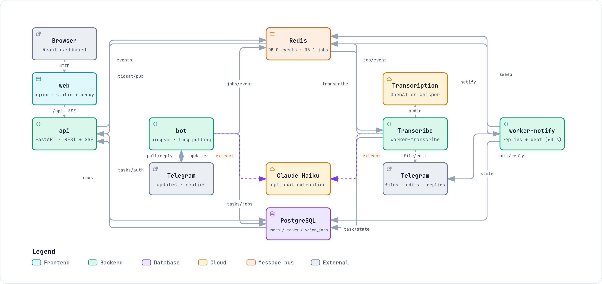

# AI Task Bot

Send a private Telegram text or voice message to create a task. Open `/dashboard`
to see tasks arrive live, move them between Pending, In Progress and Completed,
or delete them. `/tasks` lists current tasks in Telegram.

## Architecture

[](docs/architecture/system-overview.pdf)

The picture links to its PDF. Open the interactive HTML pages in a browser from a clone.
The [diagram index](docs/architecture/README.md) explains how the diagrams cite the code.

| Diagram | Shows | PDF | Interactive HTML (from a clone) |
|---|---|---|---|
| System overview | Services, connections and optional providers | [PDF](docs/architecture/system-overview.pdf) | [HTML](docs/architecture/system-overview.html) |
| Voice message | Acceptance, transcription, storage and the reply | [PDF](docs/architecture/voice-message.pdf) | [HTML](docs/architecture/voice-message.html) |
| Dashboard live updates | Sign-in, event delivery and reconnect | [PDF](docs/architecture/live-updates.pdf) | [HTML](docs/architecture/live-updates.html) |
| Voice job | States, retries, notification and recovery | [PDF](docs/architecture/voice-job.pdf) | [HTML](docs/architecture/voice-job.html) |

## Run with Docker

You need Docker with Linux containers and Compose 2.20 or newer. The stack was
checked on Docker 29.5.3 / Compose 5.1.4, on Apple Silicon. You need no local
Python, Node or database installation. Keep port 8080 free, or change `WEB_PORT`.

1. Copy the settings:

   ```sh
   cp .env.example .env
   ```

2. Put a separate test bot's token in `.env` as `TELEGRAM_BOT_TOKEN`.
   Add `OPENAI_API_KEY` for voice and `ANTHROPIC_API_KEY` for task titles and descriptions.
   The copied example selects `TRANSCRIPTION_PROVIDER=openai`, `TASK_EXTRACTOR=claude`
   and `ANTHROPIC_MODEL=claude-haiku-5-5`.
   Stop any other poller of that token, including a development bot.

3. Build and start:

   ```sh
   docker compose up --build -d --wait
   ```

   Send `/dashboard` to the bot and open its link at `http://localhost:8080`.

Voice uses OpenAI. Without `OPENAI_API_KEY`, the bot replies:
"Transcription is unavailable right now. Your message was not lost: please type it as text."
Without `ANTHROPIC_API_KEY`, text still creates a task with a title taken from the text.
The reply adds: "The language model was unavailable, so the title is taken from your text."
If `TASK_EXTRACTOR` has no value, Compose falls back to `heuristic`.

For local CPU transcription, set both lines in `.env`, then repeat step 3:

```dotenv
TRANSCRIPTION_PROVIDER=whisper_server
COMPOSE_PROFILES=whisper
```

The first Whisper start downloads and verifies the multilingual `base` model.
Keep outbound access to Hugging Face. This CPU container runs more slowly than
the development Mac's Metal server. Transcription never switches providers automatically.

## Run without a Telegram token

For this keyless example, set `TASK_EXTRACTOR=heuristic` in `.env`.
Start the other services and create a task with a dashboard link:

```sh
docker compose up --build -d --wait postgres redis migrate api worker-transcribe worker-notify web
docker compose run --rm seed 1001 "Call home and ask about the weekend."
```

Open the printed link. A new seed run rotates that user's token and invalidates
older links. Add `--keep-token` after `seed` to add tasks to an existing board.
The example uses the heuristic extractor and needs no paid API key.

## Settings

Real tokens and keys belong only in the untracked `.env`.
`.env.example` lists the settings and placeholders.

| Setting | Default / effect |
|---|---|
| `POSTGRES_USER`, `POSTGRES_PASSWORD`, `POSTGRES_DB` | Empty means `taskbot`; set all three before the first start |
| `WEB_PORT` | 8080, bound to `127.0.0.1` |
| `TRANSCRIPTION_PROVIDER` | `openai`; also `whisper_server` or `fake` |
| `OPENAI_API_KEY` | Enables OpenAI voice transcription |
| `COMPOSE_PROFILES=whisper` | Starts the local whisper.cpp container |
| `WHISPER_MODEL`, `WHISPER_MEM_LIMIT` | Supported model `base`, limit `1g` |
| `TASK_EXTRACTOR` | `claude` in the copied example; `ANTHROPIC_API_KEY` enables model-written titles and descriptions |
| `ANTHROPIC_MODEL` | `claude-haiku-5-5` |

Database credentials must use letters and digits because they enter a connection
URL. Changing `.env` after initialization does not change the database's stored
credentials. For disposable data, `docker compose down -v` resets the volumes
and deletes the tasks. Back up valuable data first; use the
[deployment guide](docs/deployment.md) for recovery.

## Services

The default project is `taskbot-app`. It publishes only nginx. The separate
shared development project `taskbot` exposes database ports through its launcher.
A plain application start does not join that project.

| Service | Responsibility |
|---|---|
| `web` | nginx, built React dashboard, same-origin `/api` and SSE proxy |
| `api` | FastAPI task reads, status changes, deletion and authenticated events |
| `bot` | Telegram long polling, task creation and private dashboard links |
| `worker-transcribe` | One Celery Linux child for voice transcription and extraction |
| `worker-notify` | Two Celery children for replies and recovery; beat sweeps every 60 s |
| `migrate` | Runs Alembic before application services; exits with status 0 |
| `postgres` | Users, tasks, original messages and voice-job state |
| `redis` | Queues, locks, realtime tickets and event delivery |
| `whisper` | Optional CPU transcription server and persistent model cache |
| `seed` | On-demand task creation and sign-in link, profile `tools` |

The long-running services report healthy; `migrate` reports exited (0).
The containers run as non-root users with read-only roots, dropped capabilities,
memory limits and rotating logs. Backend processes run under Docker's init.
The [deployment guide](docs/deployment.md) covers HTTPS, server settings,
backups, monitoring and image updates. No server has been deployed.

## Behaviour and limits

- One message produces one task. Task titles retain the message's language;
  bot replies use English. Claude Haiku writes titles and descriptions;
  a missing model key uses the text-derived fallback with a notice.
- The private dashboard uses a bearer token rather than a password. A new
  `/dashboard` link signs out other devices. The browser keeps the token in local
  storage without expiry; keep dashboard links private.
- The dark dashboard uses three desktop columns and one column per phone tab.
  You can move and delete tasks. Editing, priorities and due dates are outside
  this version. Deleting a message's last task also erases its stored source text.
- Voice accepts up to 120 seconds and 10,000,000 bytes. Progress and failures stay
  in Telegram. `fake` transcription creates a deterministic task and marks the
  reply `(demo mode)`; the Docker stack does not select it by default.
- Telegram runs in private chats with ten concurrent handlers and no per-user
  rate limit. A crash after a text commit can leave a task without a reply or live
  event. Refreshing the board shows committed tasks. A duplicate update creates
  no second task; resending as a new message does.
  A hard kill, OOM kill or stop beyond the 15-second drain can lose an update still
  in a handler; Telegram does not resend that update.
- The bot heartbeat checks healthy polling. It cannot detect ten handlers stuck
  on database locks. After a voice worker crash, recovery can wait for a
  450–460 second lease per attempt.
- Each open dashboard tab holds one event stream and one Redis subscription.
  A reconnect renews the stream ticket and reloads task state. Run one replica
  per service and one bot per token.

## Checks and operating commands

Inspect the services and logs:

```sh
docker compose ps
docker compose logs bot
docker compose logs whisper
```

A missing, malformed or rejected bot token causes a restart loop. A failed
Whisper download or unsupported `WHISPER_MODEL` makes `up --wait` fail; read the
Whisper log before sending voice. The optional dependency can warn and start
transcription while Whisper is unhealthy, so treat a failed wait as failed startup.

After testing, stop and remove the application containers:

```sh
docker compose down
```

This keeps named volumes. `unless-stopped` can otherwise restart the application
when Docker starts. The 40-second bot grace and worker grace periods allow active
work to drain; avoid forcing a stop while testing real messages.

Developers run the complete check and the isolated Docker replay:

```sh
yarn verify
node scripts/stack-acceptance.mjs
```

The replay prints R1–R7 results, uses its own project and free web port, disables
paid calls for synthetic tasks and cleans up on success, failure or Ctrl-C. It
runs without credentials by default, ignoring `.env` credentials and inherited
provider keys. Without a token, R1 reports Telegram startup, bot stop/drain and bot memory
as deferred for that replay. The owner's Docker check below covers them. `--with-telegram`
enables these checks with the test bot token in `.env`; `--keyless` explicitly
selects the default.

Verification record, 2026-10-27: development runs verified Telegram handling,
OpenAI and local Whisper voice, and the Claude extraction replay. The
[development guide](docs/development.md) keeps dates and timings. Docker checks
verified keyless sign-in, nginx, stream reconnection, persistence, dump/restore,
Linux worker failure/shutdown and real CPU Whisper inference.

Owner's Docker check, 2026-10-29, commit `48af3d8`: seven services healthy,
`migrate` exited 0, no container restart or OOM kill.
A Telegram text created a task shown live on the board; `/dashboard` signed in and opened the event stream.
Two voice messages used OpenAI on the first attempt; Claude Haiku wrote titles with `TASK_EXTRACTOR=claude`.
`/tasks` listed current tasks and reflected a board move.
After an API restart, the board reconnected without a reload.
The bot drained in 0.28 s of its 40 s grace; observed bot memory was 212 MiB of the 512 MiB limit.

That owner check did not run voice without an OpenAI key or the local Whisper container.

Native arm64 image sizes: backend 293 MB,
web 60.5 MB, Whisper 1.02 GB. No size budget applies. The model cache occupies a
separate named volume. See [development](docs/development.md) for source setup,
API details and test isolation, and [the S8 design](docs/plans/2026-10-27-s8-delivery.md)
for the accepted delivery scope.
